<a href="https://demohatesrng1.github.io/demohatesrng1/">
  <picture>
    <source media="(prefers-color-scheme: dark)" srcset="assets/github/header-dark.svg">
    <source media="(prefers-color-scheme: light)" srcset="assets/github/header-light.svg">
    
  </picture>
</a>

  <a href="https://demohatesrng1.github.io/demohatesrng1/">website</a> &nbsp;·&nbsp;
  <a href="https://demohatesrng1.github.io/demohatesrng1/ja/">日本語</a> &nbsp;·&nbsp;
  <a href="https://demohatesrng1.github.io/demohatesrng1/cv.html">cv</a> &nbsp;·&nbsp;
  <a href="mailto:onidemorng@gmail.com">say hi</a>

 

  <picture>
    <source media="(prefers-color-scheme: dark)" srcset="assets/github/stack-dark.svg">
    <source media="(prefers-color-scheme: light)" srcset="assets/github/stack-light.svg">
    
  </picture>

<em>If it doesn’t challenge you, it doesn’t change you.</em>

